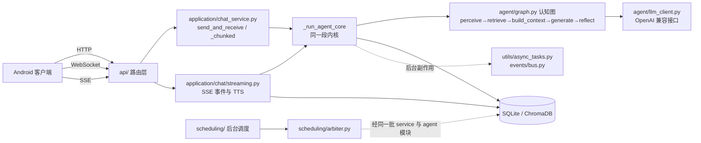

# AMBRACE 架构说明

这份文档面向想读源码、或想在自己机器上把服务跑起来的开发者。它只描述**当前仓库里真实存在的结构**，
按「怎么跑起来 → 代码怎么分层 → 一次对话经过哪些层 → 记忆与后台任务 → 权限与边界 → 怎么改与怎么验」
的顺序展开。

阅读约定：

- 文中提到的路径都是仓库内的相对路径，可直接对照源码；不写行号，因为行号会随改动漂移。
- 只承诺能在源码里找到落点的行为。凡是当前**没有**做、或者只在开关打开时才做的，都写成边界，不写成能力。
- 部署与日常运维的完整步骤在 [README.md](README.md)（英文版 [README.en.md](README.en.md)）里，本文不重复，只解释「为什么这样搭」。
- 授权范围见 [NOTICE](NOTICE)，第三方组件清单见 [THIRD_PARTY_NOTICES.md](THIRD_PARTY_NOTICES.md)，原许可文本见 [THIRD_PARTY_LICENSES/](THIRD_PARTY_LICENSES/)。

## 1. 系统形态与运行前提

AMBRACE 是**自托管**的陪伴型对话服务：中心是一个 Python 后端，客户端是配套的 Flutter Android 应用。
后端既是 HTTP/WebSocket 服务，也是后台任务的宿主；它依赖一个可写的本地数据目录和一个外部的
大模型接口。

### 1.1 后端

| 前提 | 说明 | 源码落点 |
|---|---|---|
| Python 运行时 | 官方镜像基于 Python 3.12；CI 覆盖多版本 | `Dockerfile`、`backend/requirements.txt` |
| 启动方式 | FastAPI 应用，uvicorn 承载，默认端口 8000 | `backend/app/main.py`、`backend/app/config.py` |
| 关系库 | 默认 SQLite（异步驱动），需要可写的 `backend/data/` | `backend/app/db/engine.py`、`backend/app/db/session.py` |
| 向量库 | ChromaDB 客户端 + 本机持久化目录 | `backend/app/db/vector_store.py` |
| 鉴权密钥 | JWT 签名密钥；环境变量未给时自动生成并落到数据目录 | `backend/app/auth/config.py` |
| 大模型 | 需要一个 OpenAI 兼容的对话接口（地址/密钥/模型名走配置） | `backend/app/agent/llm_client.py` |

数据目录默认布局：`backend/data/sqlite/`（库文件）、`backend/data/vector_store/`（向量索引）、
`backend/data/uploads/`（上传文件）、以及自动生成的 `backend/data/auth_secret.key`。
首次部署时引擎会主动创建缺失目录，因此**数据目录的属主必须对运行进程可写**。

### 1.2 容器化

`Dockerfile` + `docker-compose.yml` 提供完整镜像：依赖由锁文件安装，容器以非 root 用户（uid 10001）运行，
`backend/data` 与 `backend/models` 通过卷挂到宿主机。入口脚本 `scripts/docker_entrypoint.sh` 会在检测到
本地嵌入模型缺失时调用 `scripts/download_models.py` 首次下载（卷缓存，只需一次），随后前台启动服务。
镜像内随附许可文本（`LICENSE`、`NOTICE`、`THIRD_PARTY_LICENSES`），这些文件与镜像是一体的。

### 1.3 客户端

Flutter 应用，当前只交付 Android 端（`minSdk 24`）：`flutter_app/lib/` 下按 `features/`、`services/`、
`providers/`、`models/`、`core/`、`l10n/`、`theme/`、`widgets/` 分层。仓库里**没有**已适配的 iOS 原生实现；
渐进式 Web 应用（PWA）目前只是方案路线，不是已上线的客户端渠道。

## 2. 代码地图

只列主干，细节按需进目录看：

```
backend/app/
├── main.py            FastAPI 应用：lifespan（建库/迁移/加载开关/插件路由挂载）、中间件、路由清单
├── config.py          全部环境变量与默认值集中在此
├── api/               HTTP/WS 路由层（四十余个路由模块），只做参数校验、鉴权依赖、调用 service
├── auth/              JWT 签发与校验、登录限流、账号禁用与服务器管理员判定
├── application/       业务用例层：对话主链路、角色/关系/朋友圈/日记等用例、开关与用量服务
│   └── chat/          对话主链路的细分：流式(SSE/TTS)、工具、消息 IO
├── agent/             Agent 运行时：认知图、节点、状态装配、上下文分区、受控工具循环、LLM 客户端
│   └── context/       上下文分区（每个分区一个模块 + 一个分区注册表 + 装配器）
├── domain/            纯逻辑域：决策、情绪、主动性、关系衰减、思维池（不碰 IO 的判定集中在这里）
├── memory/            记忆：写入准入与去重、检索与融合、当前事实、生命周期与维护、后台提取队列
├── events/            进程内事件总线 + 领域事件落库 + 世界事实治理
├── scheduling/        后台主动调度：引擎、仲裁器、事件源、执行器、生成与闸门
├── providers/         可插拔能力（模型/语音/视觉/推送…）的注册与解析
├── plugins/           插件：清单校验、权限范围、同意与同意书、存储与注册表、SDK
├── device/            设备/手机侧的读取与动作抽象端口
├── mcp/               MCP 客户端：连接、生命周期、传输、工具适配
├── voice/             语音网关、ASR provider、音频闸门
├── models/ schemas/   ORM 模型与出参模型
├── db/                引擎、会话、建库兼容层、Alembic 集成、向量库封装
├── games/ life/ weave/ 游戏、生活面板、织图等垂直玩法域
├── utils/             日志、后台任务调度、常驻任务监督、时间工具、加解密、错误体
└── ws/                连接与通知的进程内登记表

flutter_app/lib/
├── main.dart          启动、路由、本地化、后台 isolate 注册
├── features/          按页面/功能切分的 UI 与页面级状态
├── services/          API 客户端、后台轮询与前台判定、推送、未读引擎、安全存储、设备与插件桥
└── providers/ models/ core/ l10n/ theme/ utils/ widgets/
```

一句话概括分层：`api/` 只做协议，`application/` 组织用例，`agent/`+`domain/` 负责一次回复怎么算出来，
`memory/`+`events/` 负责状态怎么被记住，`scheduling/` 负责没人说话时它自己做什么。
下层不反向依赖上层。

## 3. 一次对话：三个入口，一段公共内核

客户端连后端有三条入口，它们在**发消息**这件事上汇到同一段内核，但不是「所有功能都走同一条 Agent 链路」：

| 入口 | 路由 | 服务层函数 | 特征 |
|---|---|---|---|
| HTTP 同步 | `POST /api/v1/chat/send` | `application/chat_service.py:send_and_receive` | 一次请求等一个完整结果 |
| WebSocket | `/api/v1/chat/ws/{session_id}` | `application/chat_service.py:send_and_receive_chunked` | 长连，鉴权走 query token，收到消息先回 typing 事件，再逐块下发 |
| SSE 流式 | `POST /api/v1/chat/sessions/{id}/messages/stream` | `application/chat/streaming.py:send_and_receive_stream` | 边生成边推事件：增量文本、语义块、工具结果、结束事件 |



要点：

- **三个入口共用生成内核，但编排不完全相同**。HTTP 与 WebSocket 由聊天 service 编排；SSE 有独立的流式编排函数，调用同一个内核，并处理增量文本、逐句语音与工具结果，不能简单替换成非流式。
- **生成、落库与投递有各自时点**。SSE 的 `delta` 在生成期间发送，不要求整条回复先完成落库；确认的 `block` 带已保存的消息标识，TTS 路径可逐块保存和发送，`done` 汇总最终结果。普通与回退路径还可能在生成后批量保存。不要把三入口概括为整体落库后才开始发送；客户端正式历史仍以已保存的消息为准。
- **群聊、主动消息、小游戏是另外的入口**。它们各自有 service 与生成路径（`application/chat_groups.py`、
  `scheduling/*`、`games/*`），只是复用了同一些底层模块，不能假设「任何一句话都是同一段代码算出来的」。

### 3.1 Agent 内核

`backend/app/agent/graph.py` 用 LangGraph 编译了一条固定五节点的认知链：
`perceive → retrieve_memories → build_context → generate_response → reflect`。
其中感知与反思节点是**零模型调用**的本地判定，真正的模型调用发生在生成节点。
状态对象由 `agent/runtime.py` 构建，各节点的实现在 `agent/nodes.py`。

模型输出后可能带动作标记，`agent/loop.py` 把它变成一个**受控循环**：决定 → 执行 → 观察 → 再决定，
并设了硬上限（模型调用轮数与搜索轮数有常量约束），超限或工具失败就静默降级——剥离动作标记、
不编造工具成功。工具面分两类：内置工具（`app/tools/builtin/`，如搜索、日程、便签、生图）在 `agent/actions.py` 里解析执行；
MCP 工具由 `agent/mcp_tools.py` 走 `app/mcp/` 的连接管理，并受连接/调用超时与失败重连上限约束。

### 3.2 上下文装配

`agent/context/` 把「这一轮该给模型看什么」拆成若干**分区**：`sections.py` 是分区注册表，
`assembly.py` 是装配器，其余 `section_*.py` 每个分区一个模块。装配有配额与顺序，
`agent/context_builder.py` 负责把分区结果与对话历史合成最终消息序列。
新增一类上下文，标准做法是加一个分区模块并在注册表登记，而不是在某个调用点里临时拼字符串。

## 4. 记忆与状态

记忆不是一个向量库调用，而是几条**性质不同的通道**，各自有不同的真相来源：

| 通道 | 内容 | 落点 |
|---|---|---|
| 关系事实 | 长期记忆条目，带来源、发送者、认知状态、可信度 | `memory/write.py`、`memory/service.py` |
| 当前事实 | 「TA 现在在哪、在做什么、状态如何」这类有时效的事实 | `memory/current_state.py`、`events/facts.py` |
| 世界设定 | 角色世界里的权威事实，带核实状态与复核窗 | `events/facts.py` |
| 检索索引 | 向量候选 + BM25 稀疏索引，只用于召回排序 | `db/vector_store.py`、`memory/bm25_index.py` |
| 派生结构 | 摘要、故事线、思维池、工作状态 | `memory/summary.py`、`scheduling/storyline_engine.py`、`domain/thought/`、`memory/working_state.py` |

### 4.1 写入侧

统一入口是 `memory/write.py:save_memory`（`memory/service.py` 是它的薄转发）。一条记忆要落库，依次经过：
准入判定（来源是否可信、发送者是谁、属于哪类记忆）→ 前置过滤（明显噪声）→ 写前去重（字面/主题/向量三条判据，
命中就合并而不是新增）→ 写入 → 回执与派生钩子。这个函数被拆成了若干具名阶段，方便单测逐段钉行为。

值得注意的边界：AI 自己写下的内容**不会**自动成为权威事实。世界设定事实要经过核实状态与人工确认口径才进入每轮前提，
这是产品行为，不是实现细节（见 `events/facts.py`）。

### 4.2 检索侧

`memory/retrieve.py` 负责一次检索：多路召回（向量、BM25、实体匹配、邻域扩展）→
RRF 倒数排名融合（`memory/rrf.py`）→ 候选合并 → 关键词与时间过滤 → 重排 → 分层与配额裁剪。
两路召回各自的排序信息是被保留的（融合而非简单并集），重排再叠加重要度、时效、置顶、多路命中等加权。
`memory/tiering.py` 按置信度分层调节衰减速度与强度下限，`memory/tiers.py` 决定注入时给每条记忆多少篇幅
（摘要 / 当天概览 / 原文三层，规则固定、零模型调用）。

### 4.3 生命周期

记忆不是只进不出：`memory/lifecycle_policy.py` 是一张按事实类型的策略表（过期判定、同槽取代），
`memory/decay.py` 管强度衰减，`memory/supersede.py` 管被取代，`memory/maintain.py` 与
`memory/maintenance_schedule.py` 负责周期性维护与复习。**过期与取代都不物理删正文**，而是改状态，
让「这条曾经成立过」这件事可追溯。

### 4.4 后台提取队列

对话积累到一定量才会批量提取记忆，这条待提取队列**落盘为本机 JSON**（`memory/extract_queue.py`），
而不是放在进程内存里——否则改代码重启或崩溃时，队列里那几条对话会直接消失。

## 5. 异步副作用与一致性边界

这是理解本项目最重要的一节：**它不是一个分布式事务系统，很多副作用是「发射后不管」的。**

- 后台协程统一从 `utils/async_tasks.py:spawn_background` 发射：全局集合持强引用防 GC，
  未捕获异常统一记日志，派生时会先把「模型用量渠道」切成服务端（避免后台用量算到用户头上）。
- 常驻循环（调度器、MCP 重连等）由 `utils/supervisor.py` 监督：业务循环每轮打心跳，
  意外终止或长时间无心跳就按退避重建，状态通过 `/api/v1/system/liveness` 暴露。
  启动期「组件是否就绪」是另一件事，由 `utils/readiness.py` 判定，缺失关键组件时 `/ready` 返回 503。
- 领域事件走进程内总线 `events/bus.py`：单个订阅者异常不影响其它订阅者；广播在队列里排队时会**按事件的发出时刻判新鲜度**，
  过期就丢弃，避免一个慢订阅者把旧状态推给下游。
- **旁路事件流水不等于事务性投递 outbox**。`events/store.py` 在主业务提交后以独立事务追加持久事件，失败不回滚业务；这不是业务写入与投递任务原子提交的保证。`application/push_service.py` 尝试在线连接与离线推送，全部失败时返回离线结果，客户端重新拉取已保存历史。`scheduling/periodic_state.py` 则持久化频控与日任务失败退避，跨重启仍有门控；不能将这些恢复能力说成不存在，也不能据此承诺每条消息必达。
- **关系记忆与向量索引也不是跨库原子事务**。现有 `application/vector_sync_watch.py` 是只读对账观察，不负责写入补偿；不能把观测成功当成已实现事务性 outbox。索引一致性与消息投递应分别核查。
- 时间一律按 UTC naive 存储，比较时补时区信息；面向用户的「今天/早上」按应用时区换算（`utils/timeutil.py`、`utils/usertz.py`）。

## 6. 后台调度：没人说话的时候它在做什么

`scheduling/` 是一个独立于请求的后台循环体系：

```
scheduling/
├── scheduler.py      引擎：定时唤醒，拉起故事线/周期状态/记忆维护等循环
├── arbiter.py        仲裁：收集事件源 → 按优先级裁定 → 限额保护 → 执行
├── sources/          事件源（策略、心跳节律、未完话题、状态触发、约定/计时器、插件…）
├── executors/        执行器（对外联络、记忆、时刻、故事、小游戏…）
├── gates.py / outreach_gates.py / state_guard.py   前置闸门与现状锚
└── freshness.py      「生成前重取现状」的 IO 包装
```

两条纪律值得知道：

1. **限额与打扰时段先于生成**。配额、免打扰窗口等判定在 `gates.py` / `outreach_gates.py`，
   没通过就不进生成，避免「先生成再丢弃」这种浪费调用。
2. **已接线通道可以重新读取现状**。相应开关启用时，这些通道在调模型前使用 `scheduling/freshness.py` 重读「这件事所依赖的现状」，
   把判定交给零 IO 的纯函数 `domain/proactivity/freshness.py`，输出三档：`cancel`（不必做）、
   `regenerate`（事还该做但手里的现状过期，用新现状重写）、`keep`（照旧）。
   现状锚取不到时是 fail-open：宁可照旧生成，也不因为一次读失败就静默吞掉一次主动交流。 覆盖以实际调用点为准，不保证每条后台生成路径都有同样的复核。

`domain/` 下还有一批同性质的纯逻辑：决策层、情绪与情绪时间线、主动性节奏、关系衰减、思维池。
它们被放在这里就是为了**能被单独测试**：不 import 数据库、不 import 模型客户端，输入输出都是数据。

## 7. 多用户与权限边界

调用者身份是重要边界，业务用例传递用户与角色范围，路由鉴权依赖解析身份。资源归属校验分布在路由与服务层，不能假设所有函数使用同一签名或只在一层校验。

- **账号体系**：`users` 表是顶层主体，家庭内可以有子账号；`application/family_service.py` 解析家庭根，
  `application/tenant_scope.py` 给出统一的租户键（渠道绑定恒按家庭根解析），资源隔离口径由
  `application/tenant_service.py` 按配置切换。
- **两级管理员**：`server_admin`（服务器控制台，跨家庭、动服务器级配置）与家庭内 `is_admin` 是两件事，
  判定分别在 `permission_service.is_server_admin` 与家庭服务里，别混用。
- **账号禁用**：被禁用的账号在鉴权阶段就 403，判定走短缓存，不每请求查库；读失败放行（fail-open）。
- **归属校验**：WebSocket 握手用 query token 解出 user_id，再校验会话归属，客户端声称的 `character_id`
  必须与会话里的角色一致，否则直接拒绝。
- **插件与设备权限**：插件清单里的权限要过白名单校验（`plugins/manifest.py`），运行时还有调用方范围判定
  （`plugins/plugin_scope.py`）与用户同意记录（`plugins/plugin_consent.py`）；设备侧读取与动作分属
  `device:<id>:read` 与 `device:<id>:write`，写动作必须走注册与显式授权链路（`device/actions.py`）。

**必须说清楚的一点**：这里的鉴权是「谁能调哪个接口」，不是「公网运营所需的全套保障」。
默认 CORS 是放行、登录有基础限流（`auth/ratelimit.py`）、上传目录有按租户的静态文件闸门（`uploads_gate.py`），
但**没有**替你做 TLS 终止、WAF、异地多副本、审计合规与容量治理。要暴露到公网，请自己在前面放反向代理与 TLS，
并按 `README.md` 的运维章节配置备份与监控。

## 8. 可选能力与数据边界

多数「高级」能力都是**可选的**，且**默认关**。开关的唯一真源是代码里的默认值表（`flags/agent_flags.py`），
运行时可被数据库表 `runtime_flags` 里的记录覆盖，启动时由 `application/flag_service.py:load_runtime_flags`
读入内存。**某个键注册了，只代表它有默认值，不代表它在跑**——想知道生产实际档位，只能查运行时状态接口。
很多新能力还遵循「先影子、后实落」的推进方式：影子档只记录判据、不改变行为。

| 能力 | 是否需要外部依赖 | 数据边界 |
|---|---|---|
| 大模型对话 | 是，OpenAI 兼容接口 | 装配后的上下文（含历史、记忆、世界设定、当前事实）会发给该接口；用量统计在 `application/usage_service.py`，额度解析（全局默认 + 账号覆盖）在 `application/llm_quota.py` |
| 图片理解 / 生图 | 是，视觉模型与生图接口 | 主对话上下文使用图片的文字描述；视觉识别和生图有各自接口，使用云端视觉能力时图片可能发往所配置的视觉服务，不能概括为图片永不出网 |
| 语音合成 | 是，TTS provider | 合成文本是你的对话内容；优先云端合成，不可用时走内置兜底（**同样是联网请求**），全链路失败则这一段不出声 |
| 语音识别 | 可选，本机或云端 | 默认本机转写（模型随部署下载），不出网；显式开启云端转写时音频才会上传 |
| 推送 | 是，FCM 凭据 | 推送包含标题与通知预览，不承载完整聊天历史；预览可能来自消息内容，不能把它视为不含个人信息 |
| MCP 工具 | 是，外部 MCP server | 工具入参出参进上下文；默认拒绝内网地址（防 SSRF） |
| 插件 | 否 | 插件代码与后端同进程运行，受权限白名单、同意、超时与频率限制约束；**装插件等于把第三方代码放进你的进程** |
| 设备/手机感知 | 是，Android 侧特权通道（可选） | 读取走结构化载荷校验；不上报的结构化字段不会凭空出现 |

凭据来源有两处：环境变量与 `.env`（服务器级），或数据库里的用户级配置（BYOK）。
数据库配置字段可由 `utils/credential_crypto.py` 加密并兼容历史明文；环境变量与 `.env` 不会因此自动变成密文。备份与配置文件仍应视为敏感，**不要外发、不要上云盘、不要提交仓库**，并单独保护用于解密的本机密钥。

## 9. 扩展点

三条扩展路径，能力与代价不同：

- **Provider**（`providers/registry.py`）：注册一类可替换能力（模型、语音、视觉、推送…）。
  内置实现启动时注册，插件也能注册；调用方按能力描述解析，解析不到就抛异常而不是静默用别的。
- **插件**（`plugins/`）：面向功能的扩展，带清单校验、权限范围、用户同意、同意书文本、频率与 token 配额、
  HTTP 出站限制（默认禁内网地址、默认只允许 https）。插件可以注册 HTTP 路由、提供 hook、参与 provider 选择。
- **MCP**（`mcp/`）：把外部工具接进来，不写插件代码。连接有超时与重连上限，工具调用有调用超时。

写插件前先读 `plugins/plugin_base.py` 与 `plugins/sdk.py`：hook 是白名单语义，不是任意回调。

## 10. 数据库与迁移

- **SQLite 是默认**，异步会话工厂在 `db/session.py`，引擎在 `db/engine.py`：连接建立时打开 WAL、
  `synchronous=NORMAL`、10 秒忙等，并强制外键。单写多读的并发模型靠 WAL 支撑。
- **建库是两层**：`db/init_db.py` 是幂等兼容层（首次建表 + 增量补丁），`db/migrate.py` 负责版本记账——
  全新空库直接对齐到版本头，非空老库整链重放（迁移脚本带存在性守卫），已经是当前结构的库只对齐版本不重放。
  两者都在 lifespan 启动阶段跑。
- **版本链**在 `backend/alembic/`。**加字段请写迁移，不要改 `init_db` 里的手工 DDL**——CI 有一条专门的守卫在拦这个回潮。
- **备份**用 `scripts/backup.py`（SQLite backup API，对 WAL 库安全），日志按天轮换。

## 11. 工程实践与验证

| 目的 | 手段 |
|---|---|
| 一次性本地验证 | `scripts/verify.py`：静态检查 + 编译 + 后端测试 + 前端分析与测试（`--smoke` 再加接口冒烟） |
| 后端测试 | `backend/tests/`，pytest；测试库隔离到每会话的临时沙箱，生产库不会被测试连上 |
| 前端测试 | `flutter_app/test/`，`flutter test` |
| 复杂度棘轮 | 有一组测试盯住「超长/高复杂度的函数不许变多」，热点函数被逐步拆成具名阶段 |
| 迁移演练 | `scripts/migrate_drill.py`：拿若干历史库形态整链重放，CI 每次重活都会跑 |
| 接口冒烟 | `scripts/smoke_test.py`：登录、角色、消息、归档的最小闭环 |
| CI | `.github/workflows/ci.yml`：公开面卫生扫描、静态检查、多版本后端测试、Windows 快测、迁移演练 |
| 发布 | `scripts/make_release.py` 产出发布物；`scripts/check_public_leak.py` 扫作者机器路径与凭据形态 |

几条从这套实践里长出来的规矩，改代码前值得知道：

1. **同一判定只有一份出处**。时间窗、正则、TTL、状态口径如果发现第二份，就是 bug——要么复用，要么收敛到唯一真源。
2. **纯逻辑与 IO 分层**。`domain/` 与 `scheduling/` 的判定函数不 import 数据库/模型客户端，因此可以脱离服务单测；
   IO 包装在上一层。这是新增判据时的默认落位。
3. **重构默认「不改行为」**。把长函数拆成具名阶段时，调用时点、异常边界、事务边界、返回值都要保持，
   并用等价性测试（打桩比对重构前后的调用序列）证明，而不是靠肉眼。
4. **降级方向要偏保守**。读现状失败时 fail-open（照常做事），投递前的状态过期则 fail-closed（丢弃）——
   两种方向不一样，是因为丢一次主动交流和推一次过期状态的代价不一样。
5. **测试不许连生产库**。这是硬约束，配置与断言都在测试引导层里。

## 12. 怎么在源码里定位一件事

| 你想改的 | 先看这里 |
|---|---|
| 加一个 HTTP 接口 | `api/` 对应域的路由模块 → `application/` 的用例 → 需要的话 `schemas/` |
| 改回复怎么生成 | `agent/nodes.py` → `agent/runtime.py` → `application/chat_service.py` |
| 改「这一轮给模型看什么」 | `agent/context/section_*.py` + `sections.py` 注册表 |
| 改记忆写入 | `memory/write.py` |
| 改记忆检索排序 | `memory/retrieve.py` + `memory/rrf.py` |
| 改主动交流 | `scheduling/sources/`（什么时候想说话）、`scheduling/arbiter.py`（要不要说）、`scheduling/executors/`（怎么说） |
| 改某个开关的行为 | `flags/agent_flags.py` 的默认值 + 读它的那个模块；App 侧的展示元数据在 `application/flag_catalog.py`（只管展示，不参与生效判定） |
| 加一个模型以外的能力 | `providers/registry.py` 注册 provider，再由调用方按能力描述解析 |
| 加一个插件能做的事 | `plugins/manifest.py` 的权限白名单与 `plugins/sdk.py` 的 hook |

## 13. 这份文档不覆盖什么

- 部署的具体命令、systemd 单元、备份恢复步骤、常见故障排查：见 `README.md` 与 `scripts/README.md`。
- 运营侧（用量、成本、灰度节奏、版本发布记录）：仓库不含运营数据与内部台账。
- 客户端 UI 细节与页面级交互：`flutter_app/lib/features/` 自解释。
- 未在本仓库实现的能力一律没有出现在本文里。若你发现某段描述在源码里找不到落点，
  那更可能是文档过期了——请以源码为准，或者提 issue。
