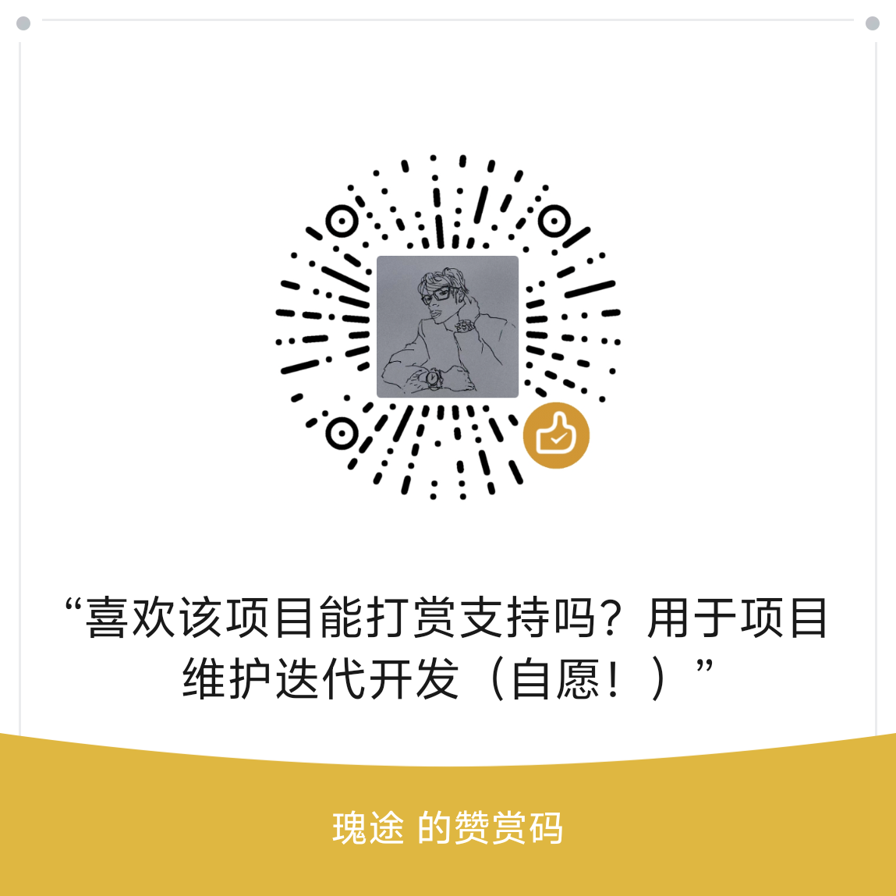

# 拥爱（AMBRACE）

[English](README.en.md) | 简体中文

自托管的 AI 伙伴陪伴应用：多个可配置的 AI 角色与你聊天、记记忆、发朋友圈、写日记、养宠物；支持实时语音通话，可选开启手机感知（读屏 / 剪贴板 / 相册 / 通知），还能把角色接到外部聊天机器人上随时聊。所有数据留在你自己的服务器上。

**当前版本**：v3.5.5 ｜ 逐版更新说明见 [`docs/changelog.md`](docs/changelog.md)（App 内「更新公告」也读这份）与 [Releases 页](https://github.com/Gi-Tuu/AMBRACE/releases)。

## 功能特性

### 客户端
- **Android App**：完整功能（后台保活、系统通知、手机感知）
- **网页版（PWA，基础体验版本地验收已收口）**：登录 / 角色 / 对话 / 只读浏览 / 文本附件 / 角色创建与基础编辑均已本地验收；后端默认不挂载入口，公网、iPhone 与真实设备尚未验证

### 聊天与语音
- **整句上屏**：AI 回复按**完整语义块**出现（不再一个字一个字往外蹦，弱网下不会一顿一顿）；生成期间在**消息即将出现的位置**显示闪烁光标，首句落地即收；弱网看门狗兜底、发送防重、断线重连不重复、SSE 心跳保活
- **逐句语音**：语音按句合成、按句顺序播放，边生成边播；随时可打断，打断即时生效（turn_id 防抖），语音回复不念「名字（神态）：」这类前缀
- **实时语音通话**：按住说话 / 自动聆听；服务端 VAD 过滤静音与极短帧；流式 / 整段 ASR 可切换
- **图片理解**：本地 OCR 识文 ＋ 云端视觉 API（OpenAI 兼容，自配端点与密钥）；**图片二进制不会进入聊天 LLM**
- **AI 生图**：聊天中可让 AI 生成图片（需自行配置生图服务，可设为「每次询问」）
- **连续发送**：连续模式先收集、再一键批量提交；多条消息按段落合并进上下文
- **已读与红点**：正在聊的时候回复到达即算已读（不等下一轮轮询、也不会闪一下又回来）；离开聊天页或退到后台前补记一次

### 角色与陪伴
- **多角色**：自定义 AI 角色（性格 / 头像 / 关系网：朋友、对象等），可逐角色配置模型与权限
- **记忆系统**：bge-m3 向量 + BM25 混合召回；记忆链条（往事按时间串链）、分层检索、记忆衰减曲线（艾宾浩斯）、织库 / 记忆本可视化
- **记得准比记得多重要**：同一件事不会记成两条（新的说法会并到旧条上，可追溯谁改的）；被更正的旧内容自动收起，不再被当成现状反复提
- **世界设定（长期知识）**：角色长期记住的事实 / 约束 / 偏好画像 / 关系基线，页面分成**「我的设定」与「TA 记下的·待你确认」两组**，每一条都能改、能删，也可**勾选多条一次删**
  - 只有你亲手写的才算「不可动摇」；角色自己编纂的内容一律标成**等你确认**，不会每轮当成前提
  - 高风险领域（身体、用药、财务、法律、人身安全）必须你明确说过或确认过才会被引用——避免把一句比喻当成健康事实，再顺着往下演绎
  - 重复条目会合并（换了说法也认得出来，用本机向量模型判定，不上传、不计费），每类还有条数上限（超限只是让出位置，不删数据）
  - 你在页面上**改一下保存**就等于「这条我确认」：条目立刻生效、层归属不变，之后再遇到同样说法也不会被重复记一遍
- **世界书 / Lorebook**：关键词 / 正则 / 概率 / 分组互斥 / 粘性 / 冷却的触发式设定注入
- **记忆按需检索**：时间检索、二跳联想、稳定知识沉淀、前瞻意图（你说过的约定与心愿会被记住并按时提起）、记忆包（`.mempak`）导出 / 导入
- **交代的事会真办**：说「帮我记一下」「那几天别安排事」会落到备忘录 / 日程，而不是只在回复里答应一句
- **主动消息**：思念 / 状态触发主动搭话，带自然度评分与作息学习；「去开会」「洗个澡」「等下试」这类约定会自动登记回访，到点自然关心，你已经说了结果就不再追问
  - **没送到不算「已经发过」**：被拦下或生成失败的主动消息会稍后再试（祝福类一天最多再试 3 回），不会因为你没见到就永久吞掉
  - **夜里与打扰节制**：静默时段、纪念日、生活汇报、群内自动冒泡等都纳入节制，不会半夜连环提醒
- **日记 / 朋友圈**：每天为角色生成第一人称日记，**夜里结算时会把当天后来发生的事补进去**；角色发动态、**彼此评论接话**（一条动态下可有多位朋友的说法，回复还会继续），多用户数据隔离
- **小家与宠物**：像素家居（多房间、家具自由摆放与编辑）；折纸风宠物领养 / 喂食 / 玩耍 / 清洁

### 群聊与游戏
- **群聊**：多角色家庭群聊，@ 指定角色回应，每角色可调话痨度与静音，三层漏斗挑人（@ 必回 → 概率激活 → 随机兜底），群记忆按发言者归属
- **群聊游戏**：6 款（谁是卧底 / 真心话大冒险 / 猜词 20 问 / 狼人杀 / 骗子酒馆 / 海龟汤），规则引擎与 AI 分离、信息隔离防作弊，过程实时推送，结束后生成「游乐手札」
- **对局护栏**：单局决策超限或异常卡局自动安全收尾（按平局结束），不再无限消耗

### 外观
- **7 款皮肤**：极光毛玻璃 / 原生态 / 温柔陪伴 / Material You / 纸艺手账 / 暗夜霓虹 / 爱琴海典藏（羊皮纸 · 星夜双版）
- **深色与主题色**：明暗模式 + 多主题色 + 字体变体，设计令牌（Design Token）统一，外观设置一键切换
- **加载与动效**：长列表骨架屏、消息入场动画、可访问性降级（减少动效时不闪不跳）

### 扩展与集成
- **插件系统**：页面型 / 零代码插件，本地目录扫描 + 远程市场索引（内置官方仓库，可用 `PLUGIN_MARKET_URL` 换成自建市场或关闭）
- **示例：论坛插件**——角色在不聊天时也能自主上论坛（读帖、回自己帖子下的留言、回私信，也可主动发帖）；**默认关闭**，需要自建论坛站点与宿主凭据
- **插件安全闸**：仅安装可信插件、安装前权限确认、来源与校验和可追溯
- **MCP 接入**：标准 Model Context Protocol（stdio / SSE / streamable-http），资源与提示词发现、调用日志可查
- **外部聊天渠道**：通过网关把聊天机器人（ClawBot）绑定到角色，机器人收到的私聊直达该角色；支持一机多主与多个机器人各绑不同角色，消息与记忆可区分来源
- **手机感知（Android）**：无障碍读屏、剪贴板、相册最近图片、通知监听、位置信息、AI 主动提通知；上报时**逐项拆字段**（应用 / 时间 / 电量 / 文件名），不挤成一句被截断
- **消息通知（Android）**：前台服务保活 + WebSocket 实时推送 + 系统通知；**退到后台或息屏也能收到**——前后台判定采用「问得到才算在前台」的保守策略，问不到就按后台处理，该弹就弹；开机自启或清数据后，后台服务会自行补建通知通道

### 管理与运维
- **权限与账号**：三合一标签页（AI 能力权限 / 主账号管理 / 服务器功能开关），主账号可管理子账号与用量
- **用量报表**：按用途 / 模型 / 按天摊开 token 与调用数，并给出按用途、按渠道的占比分布；估算用量单独计数，不与实测混读
- **功能开关**：开关页按分组折叠并附中文说明，重要能力可灰度与热切，便于逐项试新
- **桌面控制台**：跨平台（tkinter）启停 / 重启 / 看日志；服务器管理统一走 `scripts/server_manager.py`（`status` 体检、`repair` 一键修复双实例、`start/stop/restart`）
- **稳定运行**：Alembic 版本链迁移（跨版本升级不丢数据）、启动就绪检查（`/ready`）与活性端点（`/liveness`）、常驻任务自检、外部网关守护自愈、后台整理失败自动退避重试

## 技术栈
- 后端：FastAPI + SQLAlchemy(async) + SQLite + ChromaDB + bge-m3（本地向量）+ BM25 混合检索（jieba + rank-bm25）
- 前端：Flutter（**仅支持 Android 构建**，手机感知依赖 Android 原生服务），Provider + Dio + WebSocket + flutter_local_notifications + flutter_background_service（后台保活）
- LLM：任意 OpenAI 兼容端点（默认 DeepSeek，可用户级 BYOK 覆盖）；图片理解＝本地 OCR ＋ 云端视觉 API（不再依赖本地模型）
- 语音：本地 faster-whisper 转写（可切换流式 ASR 端点）；TTS 走自配语音服务（情感化合成），失败自动降级备用链路
- 部署：一键脚本（`setup.bat` / `setup.sh`）与 Docker 容器（多架构 amd64 / arm64，镜像 `ghcr.io/gi-tuu/ambrace`，首次启动自动下载模型）

## 目录结构
```
backend/          FastAPI 服务（app/ 业务代码）
flutter_app/      Flutter 客户端（lib/ 业务代码）
ambrace_core/     Flutter 共享包（消息/错误/身份/传输原语，手机壳与网页版共用）
pwa/              网页版（Flutter Web；后端默认不挂载，`PWA_STATIC_DIR` 显式配置后才在 `/pwa/` 提供）
plugins/          内置示例插件与远程市场索引（examples/ 示例、marketplace/ 索引）
scripts/          运维脚本（server_manager.py 启停/体检/修复，watchdog.py 守护，backup.py 备份，setup.bat/setup.sh 一键部署，uninstall.bat/uninstall.sh 卸载，build_apk.bat/build_apk.sh 一键打包 APK，get_server_info.py 获取服务器地址，init_db.py 手动重建表，download_models.py 下载向量模型，verify.py 一键验证）
server_controller/ 桌面控制台（跨平台 tkinter：Windows 双击 start_controller.vbs / Linux·macOS 执行 bash start_controller.sh）
docs/             开发文档（架构 / 规划 / 全景，除 changelog.md（App 更新公告数据源）外不随开源包分发）
```

## 快速开始

### 1. Docker 部署（推荐给已装 Docker 的用户）

> 容器支持仅在大版本首发（`vN.0.0`，如 `v4.0.0`）更新并验证；小版本与补丁版本不发布新镜像。`latest` 可能落后于应用版本；需要当前代码可使用下方本机部署方式。
- 拉取镜像：`docker pull ghcr.io/gi-tuu/ambrace:latest`；或用仓库根的 `docker-compose.ghcr.yml` 直接跑（免本地构建）：`docker compose -f docker-compose.ghcr.yml up -d`
- 想自行构建镜像（可改代码）：`docker compose up -d`（使用默认 `docker-compose.yml`，`build: .`）
- 首次启动会自动下载向量模型（约 542MB）；数据 / 配置经卷持久化
- 容器监听端口 **8000**；健康检查 `http://127.0.0.1:8000/api/v1/system/ready`
- 说明：模型首次下载需联网；离线可自行挂载 `backend/models` 卷

### 2. 后端（一键部署，推荐）
- Windows：运行 `setup.bat`（双击或在项目根目录执行）
- Linux / macOS：运行 `bash setup.sh`

脚本会自动创建虚拟环境、安装依赖、生成 `.env`（全部留空即可用默认）并自检模型目录。

> ⚠️ **模型说明**：向量模型 `bge-m3`（记忆系统必需，本地 ONNX 1024d，约 542MB）未纳入 git；语音转写模型 `whisper-small` 属可选功能，缺失时语音转写自动降级。获取方式：运行 `python scripts/download_models.py` 下载向量模型（离线环境可自行放置到 `backend/models/bge-m3`）；需要在多台机器间分发含模型的完整包，可用 `python scripts/make_release.py --zip` 在本机自行生成（每个版本首发提供完整包，后续修订不重复更新完整包，见第 5 节）。
>
> 🎤 **语音（可选）**：语音消息与实时语音需要额外安装 `pip install -r backend/requirements-voice.txt`（faster-whisper，懒加载，未安装时语音消息仅存音频不转写，日志会提示安装命令）；语音回复的 TTS 需自行配置语音服务，否则自动降级。

手动方式：
```bash
cd backend
python -m venv .venv
.venv/Scripts/pip install -r requirements.txt   # Windows
# Linux/macOS: .venv/bin/pip install -r requirements.txt
cp ../.env.example .env                         # 可全部留空（推荐）
```
数据库无需手动建：首次启动服务时自动建库（`backend/data/sqlite/`）。

LLM Key 推荐落库（代码/.env 零密钥）：启动后用主账号登录，进入「设置 → API 配置」填写；
落库的密钥为**加密存储**（主密钥另存于本机，不随备份包以外途径外泄）。
或直接调用管理接口（仅主账号 user_id=1）：
- `PUT /api/v1/system/api-config/server`        服务器级 LLM（聊天必需，推荐）
- `PUT /api/v1/system/image-gen-config/server`  生图（可选）

启动服务（Windows，推荐，自动拉起 watchdog 守护）：
```bash
python scripts/server_manager.py start
```
或手动（先进入 backend 目录，否则无法 import app）：
```bash
cd backend
.venv/Scripts/python -m uvicorn app.main:app --host 0.0.0.0 --port 8000   # Windows
# Linux/macOS: .venv/bin/python -m uvicorn app.main:app --host 0.0.0.0 --port 8000
```

Linux / macOS 启动（server_manager / watchdog 为 Windows 专属；桌面控制台为跨平台程序，请用下方「2.4 Linux/macOS 部署与守护」）：
```bash
cd backend
.venv/bin/python -m uvicorn app.main:app --host 0.0.0.0 --port 8000
```

`.env` 关键配置（详见 `.env.example`）：

| 变量 | 说明 |
|---|---|
| `DEEPSEEK_API_KEY` | LLM API Key（可选：推荐经管理接口落库；填此处为 .env 兜底） |
| `DEEPSEEK_BASE_URL` | API 地址，默认 `https://api.deepseek.com` |
| `LLM_MODEL` | 模型名 |
| `IMAGE_GEN_PROVIDER` | 生图 provider：`dashscope`（通义千问 Qwen-Image）或 `openai`（可选，推荐落库） |
| `SERVER_HOST` / `SERVER_PORT` | 服务监听地址，默认 `0.0.0.0:8000` |
| `DATABASE_URL` | SQLite 路径，默认 `./data/sqlite/ai_companion.db` |
| `CHROMA_PERSIST_DIR` | 向量库目录 |
| `VLM_ENABLED` | 云端识图的 `.env` 兜底开关，默认 `false`（数据库里配了识图模型即视为启用） |
| `VLM_API_KEY` | 云端视觉 API Key（OpenAI 兼容，如阿里云百炼 Qwen-VL） |
| `VLM_BASE_URL` / `VLM_MODEL` | 云端视觉端点与模型名（如 `https://xxx/compatible-mode/v1` / `qwen-vl-max`） |

### 2.1 图片理解（识图/识文）配置
默认已可用：本地 OCR 识文（随依赖安装，无需额外下载）。自然语言识图走**云端视觉 API**（2026-10-17 起已移除本地 Ollama 分支，不再需要本地模型）：
- 在 `.env` 填 `VLM_API_KEY` + `VLM_BASE_URL`（OpenAI 兼容端点，如阿里云百炼 `https://xxx/compatible-mode/v1`）+ `VLM_MODEL`（如 `qwen-vl-max`）；也可在 App 的模型设置里配置，效果相同且优先级更高。

图片二进制始终只发给本地 OCR 或你指定的视觉端点，**不会**进入聊天 LLM。

### 2.1.5 Windows 防火墙（可选）
局域网/手机访问被拦时，以管理员运行 `scripts\open_firewall.bat` 放行 8000 端口（Linux 防火墙见 2.4 第 5 步）。

### 2.2 获取服务器地址（手机端填写）
服务器启动后运行 `python scripts/get_server_info.py`，会打印局域网地址（手机与服务器同一 Wi-Fi 时填）：`http://192.168.x.x:8000`；也可登录后在 App / 桌面控制台查看（`GET /api/v1/system/status/detail`，需登录）。公开的 `/api/v1/system/status` 只返回最小状态，不含局域网地址。

### 2.3 Tailscale 远程连接（跨网络访问电脑上的服务器）
手机与电脑不在同一 Wi-Fi（用 4G/5G 流量、或人在异地）时，局域网地址不可达，推荐用 **Tailscale** 组网：把两台设备放进同一个加密虚拟局域网，电脑的 8000 端口就像在同一 Wi-Fi 一样可达。

**电脑端（服务器）**
1. 安装 Tailscale：https://tailscale.com/download（Windows 下载安装包，用微软/谷歌/邮箱账号登录即可）
2. 登录后运行 `tailscale ip -4`（或看任务栏 Tailscale 图标里的 IP），得到 `100.x.y.z` 格式的地址
3. 保持电脑开机且**不休眠**：Windows 设置 → 系统 → 电源 → 睡眠改为「从不」；笔记本合盖外接电源时也要允许不休眠，否则远程期间服务器会离线

**手机端**
1. 安装 Tailscale App（应用商店搜 Tailscale）并登录**同一账号**；若给朋友访问，由你在 https://login.tailscale.com 管理后台把朋友设备加入你的网络
2. 打开 Tailscale 的 VPN 开关（状态显示已连接）
3. App「设置 → 服务器地址」填 `http://100.x.y.z:8000`（100.x.y.z 换成电脑的 Tailscale IP）

**验证与常见问题**
- 手机浏览器访问 `http://100.x.y.z:8000/api/v1/system/status`，能看到 JSON 即连通成功；用 4G/5G 流量也能连（走加密隧道，不需要同 Wi-Fi）
- 连不上：先在电脑上确认 `tailscale status` 显示在线、服务器已启动（电脑本机访问 `http://127.0.0.1:8000/api/v1/system/status`）
- 安全提示：默认 HTTP 明文仅适合 Tailscale 私有网络内使用；如需暴露到公网请自行配置 HTTPS 反向代理

### 2.4 Linux/macOS 部署与守护
> 说明：桌面控制台（`server_controller/`）为跨平台 tkinter 程序，Windows / Linux / macOS 均可使用；`scripts/server_manager.py`、`scripts/watchdog.py` 依赖 Windows 特性（pythonw/PowerShell），**仅 Windows 可用**；Linux/macOS 用下方方式直接运行与守护，功能完全一致。

- Windows：双击 `server_controller/start_controller.vbs`
- Linux / macOS：`bash server_controller/start_controller.sh`（控制台可启动/停止/重启服务器、查看日志）

**1. 安装依赖（前置：Python 3.12+（3.14 亦可））**
```bash
bash setup.sh            # 自动建 venv、装依赖、生成 .env、自检模型目录
```
或手动：
```bash
cd backend
python3 -m venv .venv
.venv/bin/pip install -r requirements.txt
cp ../.env.example ../.env   # 可全部留空（推荐）
```

**2. 前台启动（快速验证）**
```bash
cd backend
.venv/bin/python -m uvicorn app.main:app --host 0.0.0.0 --port 8000
```
首次启动会自动建库（`backend/data/sqlite/`）与加载向量模型（约 30 秒）。浏览器访问 `http://127.0.0.1:8000/api/v1/system/status` 看到 JSON 即成功。

**3. 后台守护（推荐 systemd，Linux）**
新建 `/etc/systemd/system/ai-companion.service`（把 `/path/to/ambrace` 换成你的解压目录）：
```ini
[Unit]
Description=AMBRACE Server
After=network.target

[Service]
Type=simple
WorkingDirectory=/path/to/ambrace/backend
ExecStart=/path/to/ambrace/backend/.venv/bin/python -m uvicorn app.main:app --host 0.0.0.0 --port 8000
Restart=always
RestartSec=5

[Install]
WantedBy=multi-user.target
```
启用并启动：
```bash
sudo systemctl daemon-reload
sudo systemctl enable --now ai-companion
sudo systemctl status ai-companion        # 查看状态
journalctl -u ai-companion -f             # 实时日志
```

**4. macOS 后台守护（launchd）**
创建 `~/Library/LaunchAgents/com.aicompanion.server.plist`，plist 的 `ProgramArguments` 指向 `backend/.venv/bin/python -m uvicorn app.main:app --host 0.0.0.0 --port 8000`，`WorkingDirectory` 指向 `backend`；然后：
```bash
launchctl load ~/Library/LaunchAgents/com.aicompanion.server.plist
```

**5. 防火墙放行 8000 端口**
```bash
# ufw（Ubuntu/Debian）
sudo ufw allow 8000/tcp
# firewalld（CentOS/RHEL/Fedora）
sudo firewall-cmd --permanent --add-port=8000/tcp && sudo firewall-cmd --reload
```

**6. 日志与备份**
- 服务日志：systemd 场景用 `journalctl -u ai-companion`；其余场景 stdout 重定向到文件即可
- 每日备份：`backend/.venv/bin/python scripts/backup.py`（可配合 cron：`0 3 * * * cd /path/to/ambrace && backend/.venv/bin/python scripts/backup.py`）

**7. 局域网/Tailscale 连接**
与 Windows 一致：运行 `backend/.venv/bin/python scripts/get_server_info.py` 获取地址；跨网络用 Tailscale（见 2.3 节，电脑端安装步骤同样适用于 Linux/macOS）。

### 3. 前端（Flutter）
```bash
cd flutter_app
flutter pub get
flutter build apk --release
```
依赖拉取（`flutter pub get`）的镜像由你本机环境决定：未配置时默认官方 `pub.dev`。中国大陆网络访问不稳定时请先配置镜像：
- Windows（PowerShell）：`setx PUB_HOSTED_URL "https://pub.flutter-io.cn"`，然后**重新打开终端**
- Linux/macOS：`export PUB_HOSTED_URL=https://pub.flutter-io.cn`（可写入 `~/.bashrc`）

安装 APK 后，在设置页填入服务器地址（手机与服务器同一局域网，或经 Tailscale 等组网）。

### 3.1 安卓兼容性
- **最低系统**：Android 7.0（`minSdk` 取 Flutter 默认与 24 的较大者，Shizuku 与录音插件要求）；完整体验（手机感知/媒体读取）推荐 Android 10 及以上；`targetSdk` 随 Flutter SDK，编译产物覆盖 arm64-v8a / armeabi-v7a / x86 / x86_64 四种架构（骁龙/天玑/麒麟/展锐等主流芯片均可安装）
- **通知权限**：Android 13+ 首次打开需在系统弹窗中允许「通知」权限，否则收不到横幅/系统通知
- **定位权限（位置信息）**：在「手机感知 → 位置信息」开启「获取地理位置」时，系统会弹出定位授权（建议选「仅使用期间允许」）；若提示失败，请检查系统「定位服务」已开启、且应用定位权限未被厂商默认拦截（部分国产 ROM 需到 设置→应用→权限 手动允许）
- **手机感知权限**：需在系统设置中手动开启本应用的无障碍服务与「通知使用权」（各厂商路径不同，常见为：小米/红米 设置→更多设置→无障碍；华为/荣耀 设置→辅助功能→无障碍；OPPO/vivo/iQOO 设置→其他设置→无障碍 / 更多设置→无障碍）
- **后台稳定**：将本应用加入「电池优化白名单」并允许自启动/后台活动，否则息屏后连接与通知可能被系统杀掉（厂商 ROM 差异较大；新版通知链路已改为「拿不到确认就按后台处理」，但仍建议放行后台活动）
- **免编译安装**：不想自己编译时，可直接安装 Release 附件中的 APK（与源码同版本）；自己编译需 Flutter SDK 与 Dart SDK ≥ 3.6、Android SDK 及 **JDK 17+**（AGP 8.3 / Gradle 8.7 要求，首次构建会自动下载 Gradle 与依赖）

### 网页版基础体验（PWA）

下载 v3.5.5 起的 `ambrace_pwa.zip`，解压后将 `PWA_STATIC_DIR` 设置为其中 `pwa/` 目录的绝对路径，随后重启后端，访问同一后端地址的 `/pwa/`。默认不挂载网页版入口；无需把登录或聊天接口放到另一域名。

也可从源码构建：在 `pwa/` 中执行 `flutter build web --release --base-href /pwa/`，再将 `PWA_STATIC_DIR` 指向生成的 `build/web`。部署时请使用 HTTPS；iPhone/Safari 安装及真实设备尚未完成验证。登录只保存在当前页面内存中，刷新后需要重新登录；支持文字聊天、内容浏览、会话与本人内容编辑、单个文本附件、角色创建和基础资料编辑。

### 4. 手机感知（可选，Android）
- 在系统设置中开启本应用的无障碍服务、通知使用权（不同 ROM 名称不同，如 iQOO/OriginOS 需手动放行后台）
- 在应用内「手机感知」页打开对应开关（读屏 / 剪贴板 / 相册 / 通知 / 位置 / AI 主动提通知）
- 需要「电池优化白名单」与「允许后台启动」以保证连接与弹窗稳定

### 5. 从 GitHub 源码部署（不使用打包产物）
源码仓库与"带模型的完整包"有两点差异，补齐后功能完全一致：

1. **向量模型（必需）**：`backend/models/bge-m3`（约 542MB）未纳入 git。请运行 `python scripts/download_models.py` 下载（首次启动若缺失，后端会报错、`setup.bat/sh` 自检也会提示）。需要在机器之间分发含模型的完整包，可在本机执行 `python scripts/make_release.py --zip` 生成（输出目录由环境变量 `AMBRACE_RELEASE_OUT` 指定，缺省为项目根同级的 `release_output/`）——**每个版本首次发布提供 `ai_companion_public.zip`，同版本后续修订只更新 APK，不重复更新完整包**。
2. **APK（推荐最省事）**：直接下载 Release 附件的 APK 安装即可，无需安装 Flutter/Android SDK、无需任何配置。想自己编译：运行 `scripts\build_apk.bat`（Windows）或 `bash scripts/build_apk.sh`（Linux/macOS）一键出 release 包（加 `--debug` 可打 debug 包），或按第 3 节手动编译。

> **签名说明**：未配置密钥时编译自动使用调试签名，可正常安装使用（仅无法上架应用商店）。

其余步骤与「快速开始」完全一致：`setup.bat` / `bash setup.sh` 一键部署后端 → 运行 `get_server_info.py` 获取地址 → App 设置页填服务器地址 → 按需开启手机感知权限。

### 6. 更新（后续版本升级）
按你获取项目的方式二选一：

**从 GitHub 源码更新**
```bash
git pull                                                             # 拉取最新代码
backend/.venv/Scripts/python.exe scripts/server_manager.py restart   # Windows
# Linux: sudo systemctl restart ai-companion
# macOS: launchctl kickstart -k gui/$(id -u)/com.aicompanion.server
```
- 数据库与上传数据在 `backend/data/`（未纳入 git），更新不会动它；`.env` 原样保留
- 数据库结构变更由启动时经 Alembic 版本链自动迁移（跨版本平滑升级、不丢数据），无需手动执行迁移命令
- 依赖有变化时重跑 `setup.bat` / `bash setup.sh` 即可

**从完整发布包更新**（包由 `scripts/make_release.py --zip` 在本机生成，或沿用你之前的包）
1. 解压完整包到新目录（或覆盖旧目录）
2. 保留数据：把旧目录的 `.env`、`backend/data/`、`backend/models/` 复制到新目录（直接覆盖解压则无需处理）
3. 启动：`backend\.venv\Scripts\python.exe scripts\server_manager.py start`（Linux/macOS 用 `backend/.venv/bin/python`）
4. APK：直接安装 Release 附件里的新 APK 覆盖即可（登录态与数据保留在服务器，不受影响；build 号单调递增，可覆盖安装）

**卸载**
- Windows：`scripts\uninstall.bat`（默认保留数据与配置；追加 `--purge` 彻底清除）
- Linux / macOS：`bash scripts/uninstall.sh`（同上）

## 备份与恢复
- **App 一键导出**：设置 → 系统 → 数据备份，点击「导出备份」即可把 SQLite 数据库 + 配置 + 源码快照打包成 zip 保存到手机，并附恢复指引。
- **服务器端自动备份**：`scripts/backup.py` 每日自动备份到 `backups/` 目录（保留最近 14 天），也可手动执行；同时清理 7 天前的轮转日志与 7 天前的主动触发日志。备份内容 = 源码目录（backend/app、scripts、server_controller、flutter_app/lib、docs）+ 关键文件 + 主数据库（SQLite backup API，运行中可安全复制）+ `server_config.json` + 提取任务快照（`extract_queue.sqlite3`，存在时）。
- **凭据加密（A8 方案 B，2026-09-26 起）**：库内模型 / 语音 / 多模态密钥为**加密存储**（AES-256-GCM，密文 `enc:v1:` 前缀）；解密主密钥 `backend/data/secrets.key` 与登录签名密钥、服务器身份密钥、推送服务账号**一律不进备份包**。若库内字段仍为明文（旧库未跑过 `backend/scripts/encrypt_credentials.py --apply`），包内该部分仍是明文——包内 `README-BACKUP.txt` 有同样提示：**不要外发、不要上传网盘、不要提交进仓库**。
- **恢复**：停止服务 → 解压备份 zip 覆盖 `backend/data`（跨机器恢复还须另拷 `backend/data/secrets.key`，主密钥丢失则凭据无法还原，只能在设置里重新填写）→ 重新启动服务。
- **候选发版前的迁移演练与恢复自检**（隔离工作区专用，不连生产库）：`scripts/candidate_preflight.py` 做迁移单头/父链/CLI 交叉验证与三包 path 依赖边界检查；真正的迁移与恢复演练是 `backend/tests/test_candidate_migration_rehearsal.py`（pytest，真实 Alembic 子进程 + 独占临时库）。演练的恢复比较是**全行逐字 + 结构等价**（六表 `SELECT *` 全部列、DDL/索引、FK 声明、序列水位、`integrity_check`）。预检工具的目录安全门只保证「受控根由本轮独占新建、祖先无 symlink/junction 别名、探测失败即拒绝、写出口独占创建不覆盖」——**安全门就绪 ≠ 迁移演练通过**。演练手册见 `docs/migrate-drill.md` §7。

## 开发与测试
改完想自检，按影响面挑一条：

```bash
# 后端（在 backend 目录下）
.venv/Scripts/python.exe -m pytest tests -q --basetemp=.pytest_tmp      # Windows
.venv/bin/python -m pytest tests -q                                     # Linux / macOS
.venv/Scripts/python.exe -m ruff check app                              # 静态检查

# 前端（在 flutter_app 目录下）
flutter analyze
flutter test

# 一键验证（ruff + 语法编译 + 后端测试 + 前端 analyze/test；加 --smoke 顺带跑接口冒烟）
backend/.venv/Scripts/python.exe scripts/verify.py

# 接口冒烟（需要服务已启动）
backend/.venv/Scripts/python.exe scripts/smoke_test.py
```

- **CI**：`main` 分支每次推送都会跑 `.github/workflows/ci.yml` —— 常开档为 Flutter（analyze + test）与后端 Linux Python 3.12 / 3.13 / 3.14；后端 Windows 档由变更面判定（只动前端与文档时跳过）；Docker 构建/冒烟仅在精确大版本首发 tag（`vN.0.0`）运行。
- **本机绿不等于 CI 绿**：CI 检出的是**去掉内部文档与隐私排除文件**的那份文件集，会读仓库文件的测试要在这份树上跑过才算数；`scripts/check_pruned_tree.py` 可在推送前先在裁剪树上预跑一次。
- **公开面自查**：`scripts/check_public_leak.py` 按同一份排除清单扫描「作者机器路径 + 凭据形态」，命中即非零退出；`public-hygiene` 档每次推送都会跑。
- **隐私硬原则**：真实用户数据（对话、记忆、昵称、宠物名等及其派生改写内容）不得进入公开仓库，相关题集与文档一律走排除清单，并由守卫断言「不在公开面」。

## 隐私说明
- 图片默认仅本地 OCR 识文；开启识图后，图片二进制只发给你自填的视觉 API 端点，**不会**进入聊天 LLM
- 数据默认全部存在你自己的服务器（SQLite + 本地向量库）
- 手机感知数据仅用于注入 AI 上下文，本仓库不包含任何收集上报
- 语义去重与向量检索都用**本机模型**，不会因为"查重"而调用外部服务
- 服务器保存的模型 / 语音密钥为加密存储（主密钥另存于本机且不进备份包，见上方「备份与恢复」的提示）

## 开源与许可
- 代码许可：**AGPL-3.0-only**（[完整条文](LICENSE)，GNU Affero 通用公共许可证第 3 版），**自 v3.5.4 起生效**；v3.5.3 及更早版本为 MIT，那些版本与 tag 是历史记录，不再追改。
- [NOTICE](NOTICE)：授权范围与边界的中英说明（谁被授权什么、商用与商标怎么算、什么不在授权范围内）。
- [THIRD_PARTY_NOTICES.md](THIRD_PARTY_NOTICES.md)：第三方组件（Python / Flutter / 模型权重 / 素材）逐项清单与义务；原许可逐字副本在 [THIRD_PARTY_LICENSES/](THIRD_PARTY_LICENSES/)，可用 `scripts/collect_license_notices.py --verify` 校验。
- ⚠ **这份许可不禁止商业用途，也不禁止收费**：你可以商用，也可以因此收费。需要遵守的是 AGPL 本身——
  - 对外**分发**（无论改没改过）→ 遵守第 4–6 条的适用要求；分发目标代码时采用第 6 条允许且适用于该分发形式的源码提供方式，不能一律以书面要约代替；
  - 把**修改过的**版本开放给其他人通过网络交互 → 按第 13 条向这些使用者提供你修改版的对应源码；
  - 自己运行、或只自用托管未修改的副本，本身不触发源码提供义务。
- 想支持维护可以[联系作者](#支持作者)（自愿倡议，**不是**许可条件；从不联系作者同样合规）。
- **商标**：本许可不授予任何商标权。请勿把修改版或重新打包的版本当作官方版发布，或以可能造成来源混淆的方式呈现。
- 第三方模型与服务（LLM / 视觉 / 语音 / 生图）由你自行申请与付费，相关条款以其官方说明为准。

## 支持作者
如果这个项目给你带来了陪伴与快乐，欢迎支持作者 ☕

- **爱发电**：[前往爱发电支持作者](https://www.ifdian.net/a/gituu)
- **微信赞赏**：微信扫描下方赞赏码（金额随意，支持即动力）
- **抖音**：关注作者抖音 `dsOHOTzx`（复制到抖音搜索即可）
- **QQ 群**：加入作者交流群 `1065741798`（复制到 QQ 搜索加群）


